<p align="center">
  <a href="https://gittree.app">
    
  </a>
</p>

<h1 align="center">GitTree</h1>

<p align="center">
  <strong>A visual Git client for macOS, Windows and Linux.</strong><br>
  See every branch in one commit graph, stage single lines, resolve conflicts side by side and undo risky steps.<br>
  Your repositories stay on your computer. GitTree Pro adds pull requests, CI/CD runs and Nour, the AI assistant.
</p>

<p align="center">
  <a href="https://github.com/git-tree-app/gittree/releases/latest"></a>
  <a href="https://github.com/git-tree-app/gittree/releases"></a>
  
  
  
  <a href="https://gittree.app/en/pricing"></a>
  
  
</p>

<p align="center">
  <a href="https://gittree.app/api/download/macos"><strong>Download for macOS</strong></a>
  &nbsp;·&nbsp;
  <a href="https://gittree.app/api/download/windows"><strong>Download for Windows</strong></a>
  &nbsp;·&nbsp;
  <a href="https://gittree.app/api/download/linux"><strong>Download for Linux</strong></a>
  <br>
  <a href="https://gittree.app">Website</a>
  &nbsp;·&nbsp;
  <a href="https://gittree.app/en/features">Features</a>
  &nbsp;·&nbsp;
  <a href="https://gittree.app/en/pricing">Pricing</a>
  &nbsp;·&nbsp;
  <a href="https://gittree.app/en/docs">Docs</a>
  &nbsp;·&nbsp;
  <a href="https://gittree.app/en/tour">2-minute tour</a>
  &nbsp;·&nbsp;
  <a href="https://gittree.app/en/changelog">What's new</a>
  &nbsp;·&nbsp;
  <a href="https://gittree.app/en/support">Support</a>
  &nbsp;·&nbsp;
  <a href="https://gittree.app/ar">العربية</a>
</p>

<p align="center">
  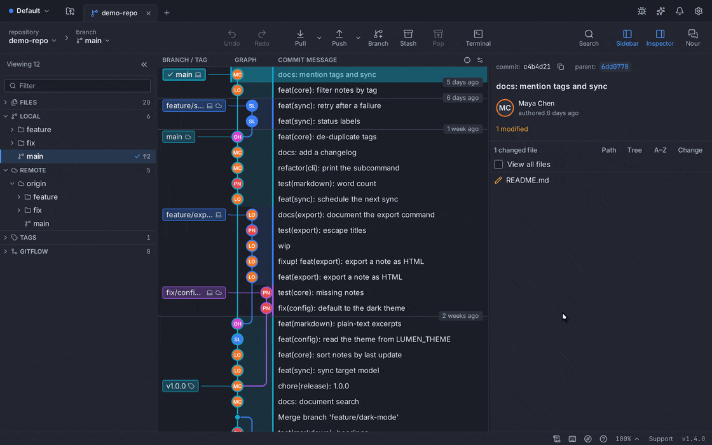
</p>

<p align="center">
  <sub>Recorded from the real app, not a mock-up.</sub>
</p>

---

## Contents

- [Download](#download)
- [About this repository](#about-this-repository)
- [Why GitTree](#why-gittree)
- [Plans](#plans)
- [Features](#features)
- [Installation](#installation)
- [Getting started](#getting-started)
- [How to…](#how-to)
- [Keyboard shortcuts](#keyboard-shortcuts)
- [Your GitTree account](#your-gittree-account)
- [Privacy and security](#privacy-and-security)
- [Updating and uninstalling](#updating-and-uninstalling)
- [Troubleshooting](#troubleshooting)
- [FAQ](#faq)
- [Feedback and support](#feedback-and-support)
- [About GitTree](#about-gittree)
- [Legal](#legal)
- [بالعربية](#بالعربية)

---

## Download

| Platform | Requirements | Installer | Download |
|---|---|---|---|
| **macOS** | macOS 13 Ventura or later, Apple silicon and Intel | One universal `.dmg`, signed and notarized by Apple | [**Download for macOS**](https://gittree.app/api/download/macos) |
| **Windows** | Windows 10 (22H2) or Windows 11, 64-bit | x64 installer `…_x64-setup.exe` | [**Download for Windows**](https://gittree.app/api/download/windows) |
| **Linux** | Ubuntu 22.04 LTS or later, Debian 12 or later and their derivatives, 64-bit (x86_64) | Debian package `…_amd64.deb` (recommended) | [**Download the .deb**](https://gittree.app/api/download/linux) |
| **Linux, other distributions** | 64-bit (x86_64) with glibc 2.35 or newer | Portable `…_amd64.AppImage` | [**Download the AppImage**](https://gittree.app/api/download/linux-appimage) |

The download links always serve the installer of the **newest stable release** from this repository. Every version, with its release notes and checksums, is on the [**Releases page**](https://github.com/git-tree-app/gittree/releases), and the website has a download page too: [gittree.app/en/download](https://gittree.app/en/download).

Prefer links served by GitHub itself? These names never change and always point to the newest release:
[`Git-Tree-macOS.dmg`](https://github.com/git-tree-app/gittree/releases/latest/download/Git-Tree-macOS.dmg) ·
[`Git-Tree-Windows-setup.exe`](https://github.com/git-tree-app/gittree/releases/latest/download/Git-Tree-Windows-setup.exe) ·
[`Git-Tree-Linux.deb`](https://github.com/git-tree-app/gittree/releases/latest/download/Git-Tree-Linux.deb) ·
[`Git-Tree-Linux.AppImage`](https://github.com/git-tree-app/gittree/releases/latest/download/Git-Tree-Linux.AppImage).

> [!NOTE]
> GitTree uses **your own Git** (version 2.39 or newer). If Git is missing or too old, the app tells you how to install it: see [Install Git](#install-git). Ubuntu 22.04 and Linux Mint 21 ship an older Git, so they need one extra step.

## About this repository

This is the **public home of GitTree**: its releases, its public files and its issue forms. GitTree is closed-source software: the source code of the app, the website and the account service is private and is never published here.

| You'll find here | |
|---|---|
| **Releases** | Installers for macOS (`.dmg`), Windows (`.exe`) and Linux (`.deb`, `.AppImage`), each with a detached `.sig` signature, plus release notes and `SHA256SUMS.txt`, on the [Releases page](https://github.com/git-tree-app/gittree/releases). |
| **Issue forms** | [Bug reports, crash reports and feature requests](https://github.com/git-tree-app/gittree/issues/new/choose). |
| **Public files** | This README, [`RELEASING.md`](RELEASING.md) (the release asset contract) and the logo, screenshots and demo in `.github/assets/`. |

The website, [**gittree.app**](https://gittree.app), and the in-app updater both read this repository's releases: when a new version is published here, the download buttons and the update bar offer it within minutes.

## Why GitTree

- **See your whole repository.** Every branch gets its own colour-coded lane, so merges, releases and feature work read at a glance, even in very large histories.
- **Every everyday Git action is one click away.** Stage, commit, branch, merge, rebase, stash, pull and push from the graph, the toolbar, a right-click or the command palette. Menus name both branches ("Merge `feature/search` into `develop`"), so you always know which way changes move.
- **Mistakes are recoverable.** Destructive actions save a snapshot first, and **Undo** and **Redo** in the toolbar reverse them. The merge dialog warns before a merge would conflict. Force-push always uses `--force-with-lease`. Dangerous dialogs focus **Cancel**.
- **Your own Git, your own machine.** Every command runs through the Git you already have, so the result matches the command line. Repositories never leave your computer, and the app sends no usage telemetry.
- **The same app on macOS, Windows and Linux.** A small, fast desktop app built with Rust and Tauri that follows each platform's window controls, shortcuts, keychain and file system.
- **English and Arabic.** The whole app, the website and the docs are available in both, with a full right-to-left layout in Arabic.

## Plans

| | **Free** | **Pro** | **Pro for organizations** |
|---|---|---|---|
| Who it's for | Everyone | Individuals | Teams and companies (per seat, at least 3 seats) |
| Every local Git feature in this README (graph, staging, merge, rebase, conflicts, undo, stash, worktrees, terminal…) | ✅ | ✅ | ✅ |
| Private repositories and commercial use | ✅ | ✅ | ✅ |
| macOS, Windows and Linux | ✅ | ✅ | ✅ |
| Hosting integrations: GitHub, GitLab, Bitbucket and Azure DevOps pull requests, issues, checks and CI/CD runs | | ✅ | ✅ |
| **Nour**, the AI assistant, and AI drafting of commit messages and pull request descriptions | | ✅ | ✅ |
| **Repo Insights**: commits, lines and files changed over time, worked out on your computer | | ✅ | ✅ |
| Create organizations, invite members, manage roles and seats | | ✅ | ✅ |

All plans need a free GitTree account to sign in. Pro comes with a free trial that starts only when you choose it, and nothing renews automatically. Current prices and offers for your country are on the [**Pricing page**](https://gittree.app/en/pricing).

## Features

GitTree covers the commands developers use every day, plus the advanced ones you reach for when something needs fixing. The complete, always-current list is on [gittree.app/en/features](https://gittree.app/en/features).

### Commit graph

- **Colour-coded branch lanes** with smooth curves where branches fork and merge.
- **Fast on large repositories**: the graph pages through history as you scroll.
- **Labels on the graph**: local branches, remote branches and tags next to the commits they point to, with avatars and relative dates.
- **Search and filter**: find commits by message, author or hash; show, hide or focus branches.
- **Work-in-progress row**: uncommitted changes sit at the top of the graph with a count of what changed.
- **Drag and drop**: drag a branch onto another branch to merge or rebase it.

<p align="center">
  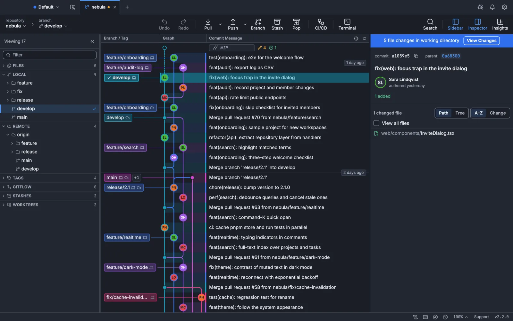
</p>

### Staging and commits

- **File, hunk and line staging**: stage or unstage a whole file, one hunk or individual lines.
- **Discard with a safety net**: discarding asks first and keeps a copy you can restore.
- **Commit, amend and co-authors** in one place.
- **Message checks**: a live counter keeps the summary within 72 characters; templates and recent messages are one click away.
- **Signed commits** with the GPG or SSH keys you already use.
- **`.gitignore` editor**: ignore a file or pattern from its context menu, or edit `.gitignore` with templates.

<table>
  <tr>
    <td width="50%">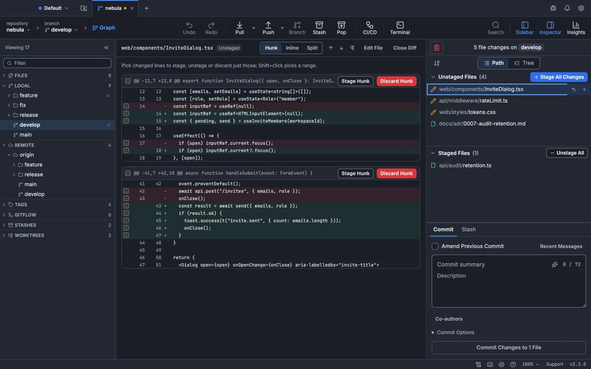</td>
    <td width="50%">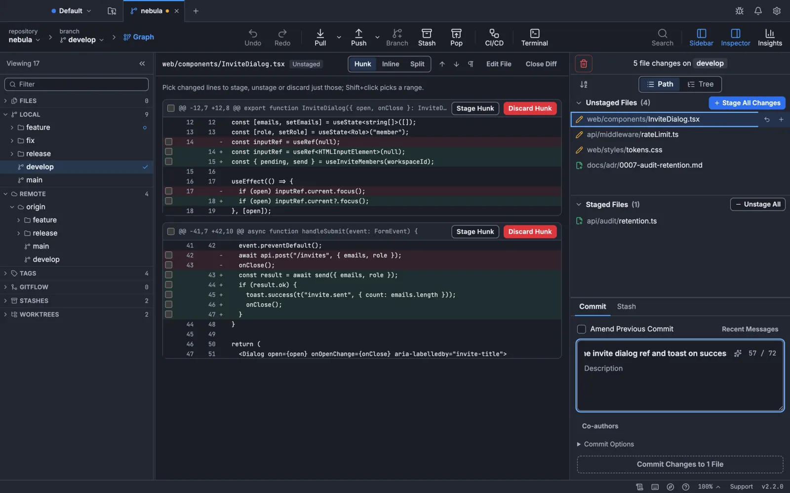</td>
  </tr>
  <tr>
    <td align="center"><sub>Stage a file, a hunk or single lines</sub></td>
    <td align="center"><sub>Write the message with a live summary check</sub></td>
  </tr>
</table>

### Diff, blame and history

- **Split and inline diffs** with syntax highlighting for dozens of languages and whitespace options.
- **Blame**: see who last changed every line and jump to that commit.
- **File history** that follows a file through renames.
- **Compare anything**: two branches, tags or commits, or a commit with your working folder.
- **Image diffs**: compare image files side by side, in commits and in your working changes.
- **File browser**: browse the repository's files and open them from the sidebar.

<p align="center">
  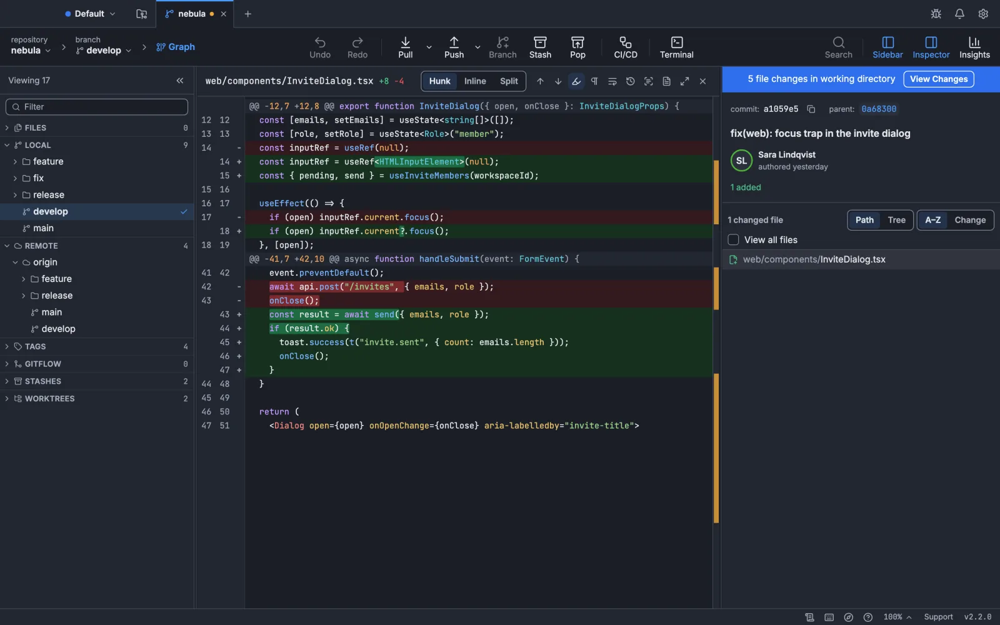
</p>

### Branches and tags

- **Create, rename and delete**: branch from any commit; rename or delete safely.
- **Checkout with protection**: a warning before a checkout would overwrite your local changes.
- **Tags**: lightweight or annotated; push and delete them.
- **Upstream tracking**: ahead/behind counts for every branch and one-click upstream setup.
- **Git Flow**: start and finish feature, release and hotfix branches.

### Merge, rebase and conflicts

- **Merge and fast-forward**: menus name both branches, and the merge dialog says whether the merge will conflict before anything changes.
- **Rebase** onto any branch or commit, with continue, skip and abort in one place.
- **Cherry-pick and revert**: copy a commit onto your branch, or undo it with a new commit.
- **Reset**: soft, mixed and hard, each with a plain-language explanation.
- **Three-way conflict editor**: both sides next to each other and the merged output below; take a side line by line, combine both or edit the result, then mark the file resolved.

<p align="center">
  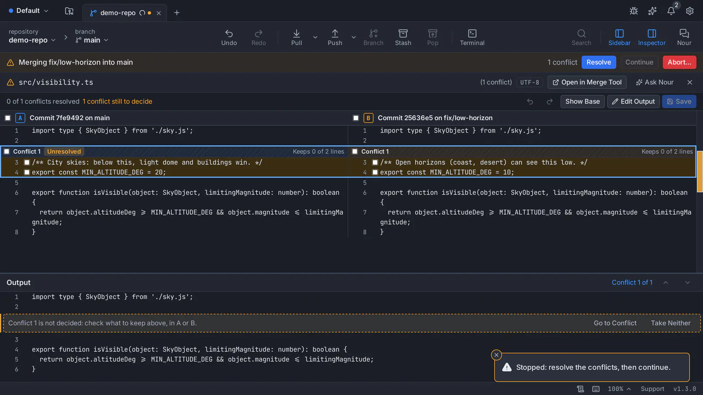
</p>

<table>
  <tr>
    <td width="50%">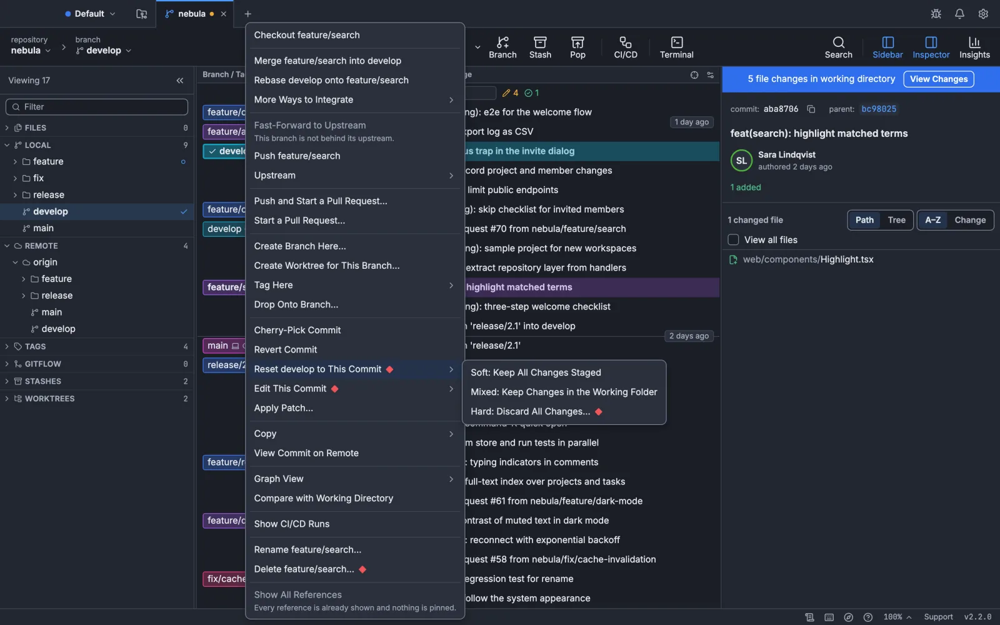</td>
    <td width="50%">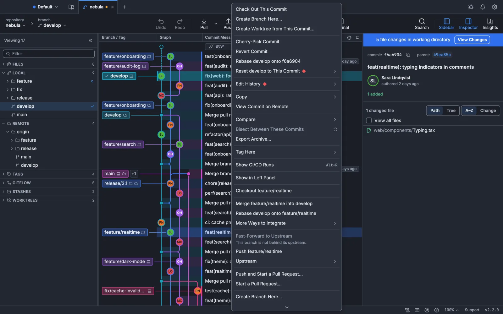</td>
  </tr>
  <tr>
    <td align="center"><sub>Branch menu: every action names both branches</sub></td>
    <td align="center"><sub>Commit menu: cherry-pick, revert, branch, tag, compare</sub></td>
  </tr>
</table>

### Rewrite history and undo

- **Interactive rebase**: reorder by dragging, then pick, reword, edit, squash, fixup or drop. GitTree shows exactly what will be replayed before anything changes.
- **Quick edits**: reword, move, squash or drop a single commit straight from its menu.
- **Undo and redo**: reverse resets, discards, branch deletions and rebases from the toolbar.
- **Reflog**: browse it and recover a lost commit onto a new branch.
- **Bisect**: find the commit that introduced a bug by marking commits good or bad.

<p align="center">
  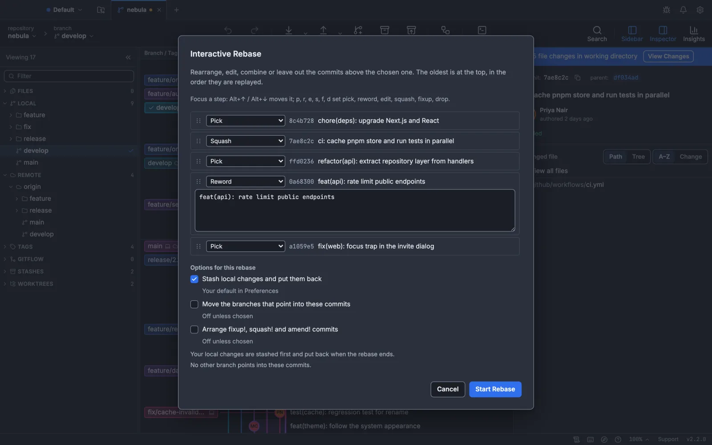
</p>

### Stash, worktrees, submodules and LFS

- **Stash**: stash, apply, pop, rename and drop, or turn a stash into a branch.
- **Worktrees**: check out several branches at once in separate folders, from the sidebar.
- **Submodules**: add, initialise, update and sync.
- **Git LFS**: track patterns, pull large files and manage file locks.
- **Patches**: create a patch from commits and apply patches from others.
- **Repository maintenance**: optional housekeeping that speeds up status and graph loading, run only when you ask.

### Remotes and sync

- **Fetch, pull and push**: choose fast-forward only, merge or rebase for every pull.
- **Safe force-push**: always `--force-with-lease` with the expected commit.
- **Multiple remotes** over HTTPS or SSH: add, edit, prune and remove.
- **Shallow history**: work with shallow clones and fetch more history when you need it.

### Pull requests, issues and CI/CD (Pro)

- **Connect your hosting accounts**: GitHub, GitLab, Bitbucket and Azure DevOps, in the cloud and self-hosted. Tokens are stored in your system keychain.
- **Pull requests**: list, create, review, comment on and merge them, browse their changed files as a tree and see their checks, without leaving the app.
- **Issues** for the open repository in the sidebar.
- **CI/CD runs**: runs, jobs and live logs, re-run failed jobs, cancel, approve and dispatch workflows for supported providers.
- **Browse, clone and publish** repositories from your accounts without copying a URL.

<p align="center">
  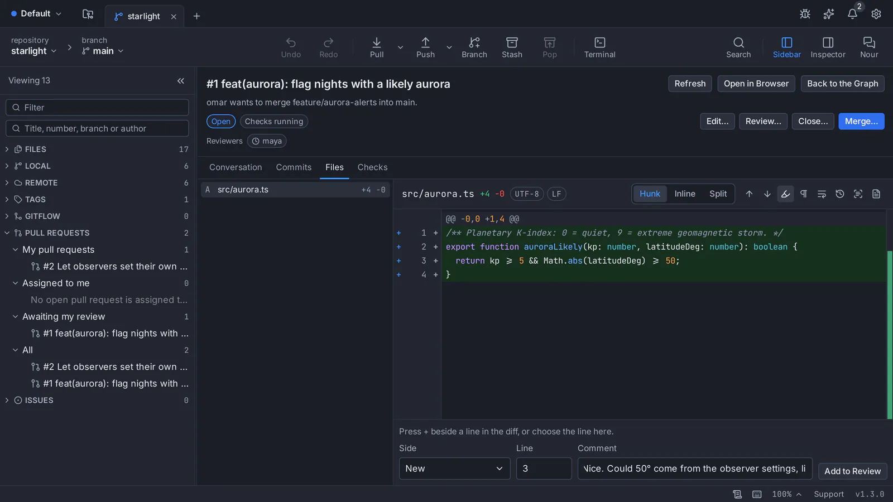
</p>

<p align="center">
  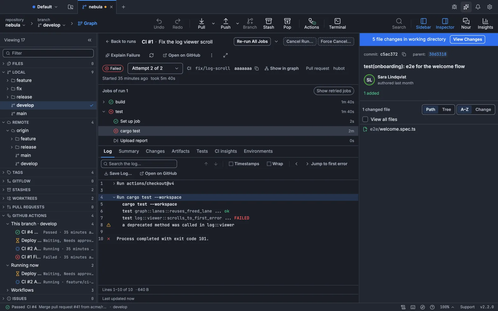
</p>

### Nour, the AI assistant (Pro)

- **Ask about your repository**: its history, its code, what changed on a branch or whether your working changes look risky.
- **Agent mode**: let Nour edit files and run commands in a repository you trust, with a snapshot before every turn so **Undo** can take it back.
- **AI drafting**: commit messages and pull request descriptions drafted from your changes.
- **Your own coding agent**: Nour runs the coding-agent CLI you already use (such as Claude Code, Codex or Gemini CLI) under that agent's own plan and terms. GitTree stores no AI key and sells no AI credits, and nothing is sent until you ask.

<p align="center">
  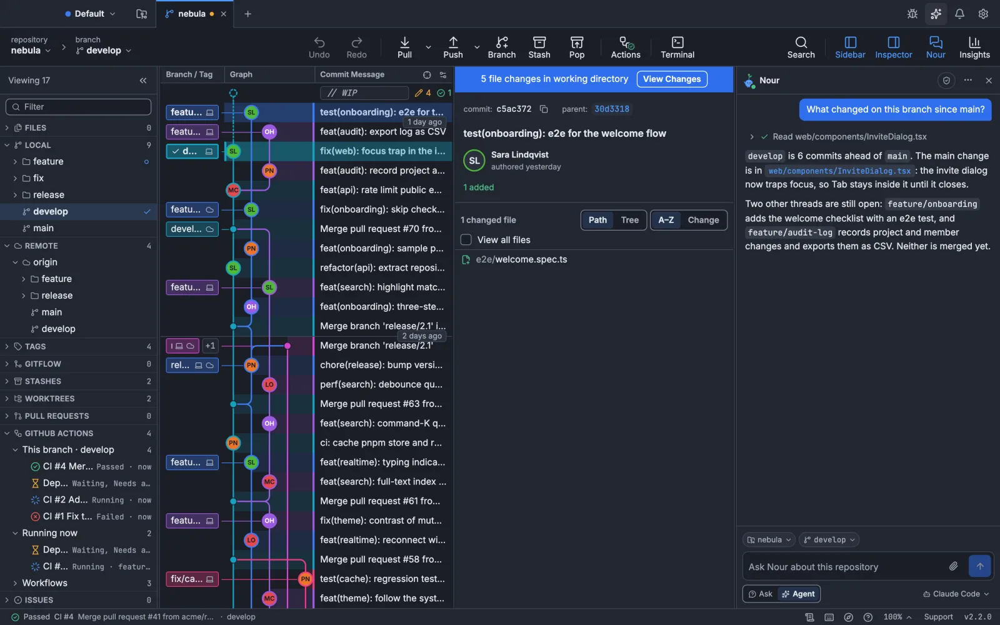
</p>

### Repo Insights (Pro)

- **See how a repository moves**: commits, lines and files changed over time, a weekly chart and contributors by name.
- **Worked out on your computer** from the repository's local history: nothing is uploaded.
- **Honest numbers**: the report says what it leaves out, such as a shallow clone's missing history.
- **Its own window**: open Insights next to your work, keep earlier reports, and export a report as CSV or JSON.

<p align="center">
  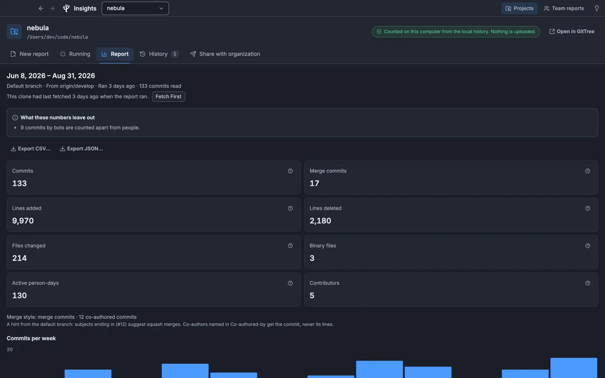
</p>

### Speed and productivity

- **Command palette**: <kbd>⌘</kbd><kbd>⇧</kbd><kbd>P</kbd> / <kbd>Ctrl</kbd><kbd>Shift</kbd><kbd>P</kbd> runs any command, jumps to a branch, finds a commit or opens a file.
- **Rebindable shortcuts**: every command has a shortcut you can change.
- **Built-in terminal** docked under the graph, opened at the repository root with your own shell and profile; the graph refreshes when the repository changes.
- **Tabs and workspaces**: open many repositories in tabs and group them into workspaces; your session comes back as you left it.
- **Custom commands**: add your own commands and scripts.

<table>
  <tr>
    <td width="50%">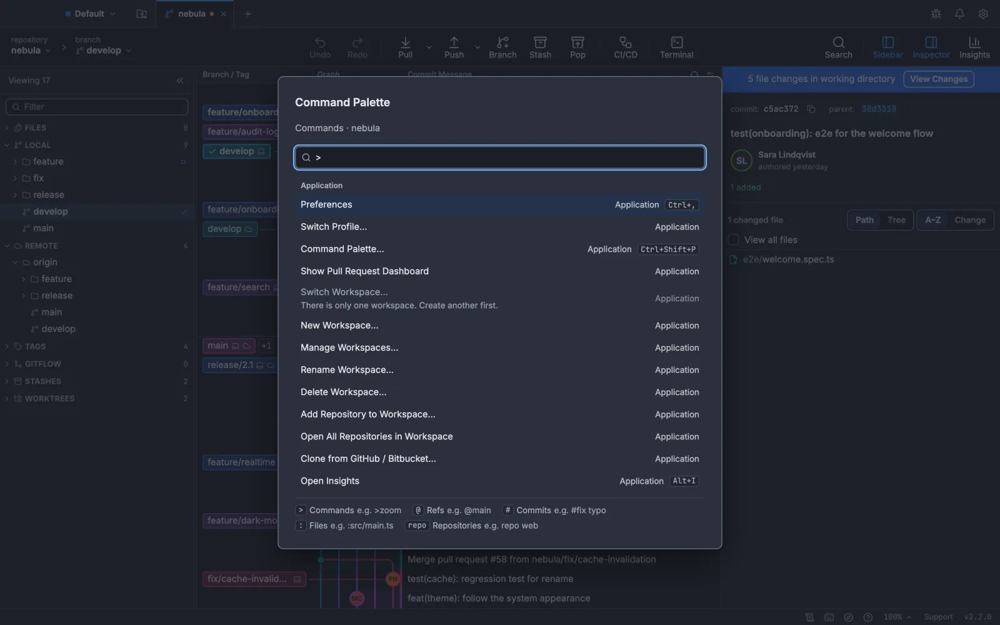</td>
    <td width="50%">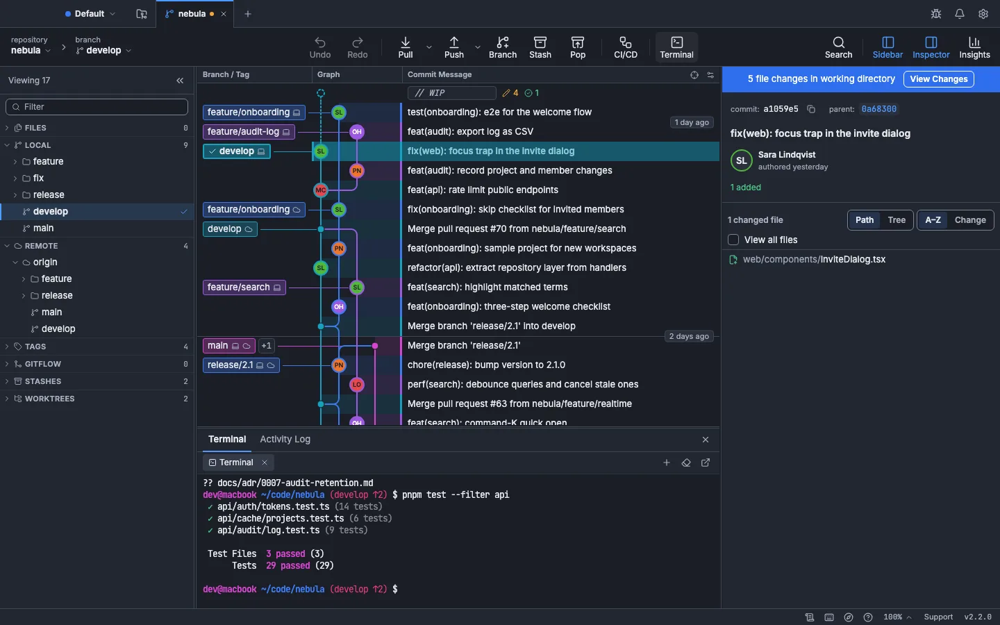</td>
  </tr>
  <tr>
    <td align="center"><sub>Command palette</sub></td>
    <td align="center"><sub>Built-in terminal</sub></td>
  </tr>
</table>

### Repositories: open, clone, init

- **Open, clone or init** from the start page, with recent and favourite repositories.
- **Clone over HTTPS or SSH**, including shallow, sparse and blobless clones.
- **Scan for Repositories** in a folder to find the ones you already have.
- **Repository trust**: a repository whose settings or hooks could run programs asks before it is trusted, or opens in Restricted mode.
- **Bare repositories** open read-only, with their graph, branches and tags.

<table>
  <tr>
    <td width="50%">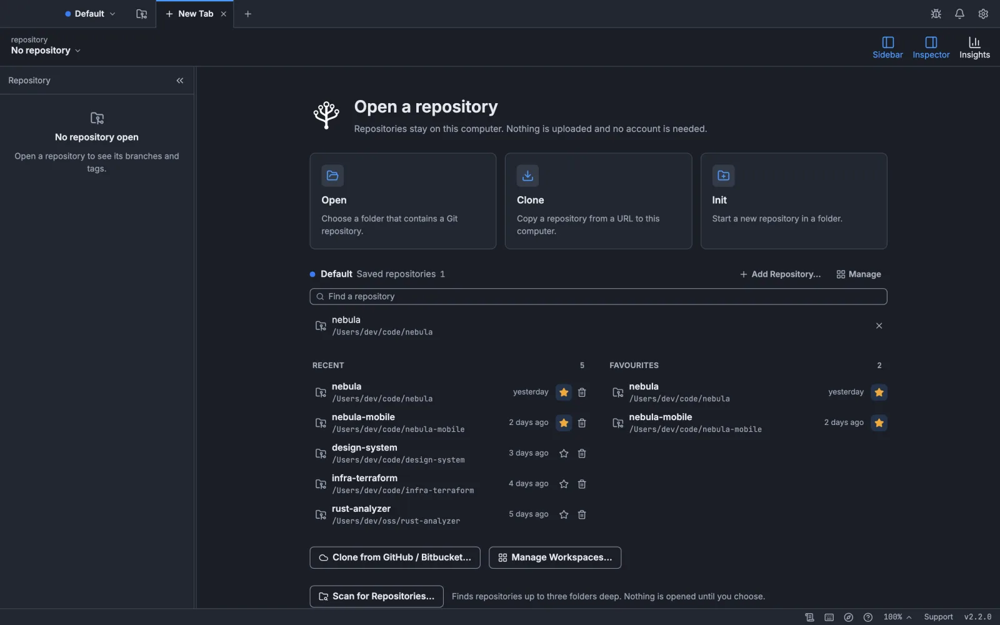</td>
    <td width="50%">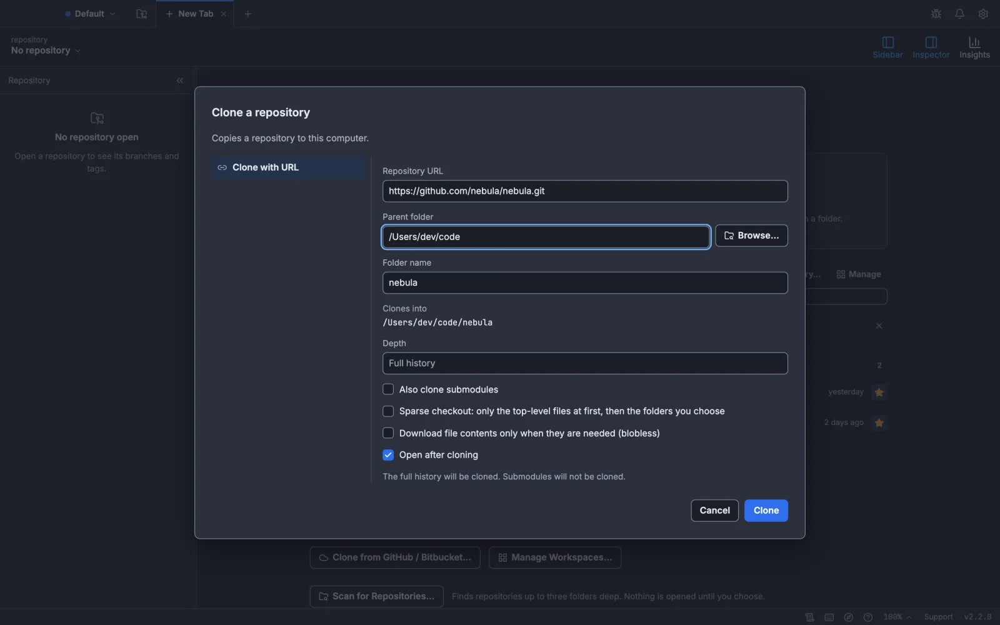</td>
  </tr>
  <tr>
    <td align="center"><sub>Start page</sub></td>
    <td align="center"><sub>Clone with depth, sparse and blobless options</sub></td>
  </tr>
</table>

### Preferences and customisation

- **Searchable preferences**: find any setting by name, description or key, and reset it on its own.
- **Themes**: dark, light and high-contrast, plus your own imported themes.
- **Language**: English or Arabic, with a right-to-left layout in Arabic.
- **SSH and signing**: manage SSH keys and configure commit signing.
- **External tools**: open diffs and merges in the tools you prefer.
- **Profiles**: switch between identities (name, email, signing key) for work and personal projects.

<table>
  <tr>
    <td width="50%">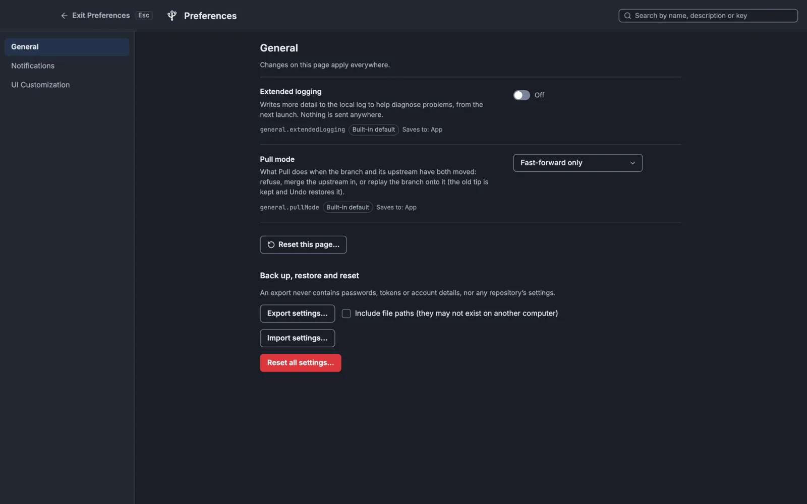</td>
    <td width="50%">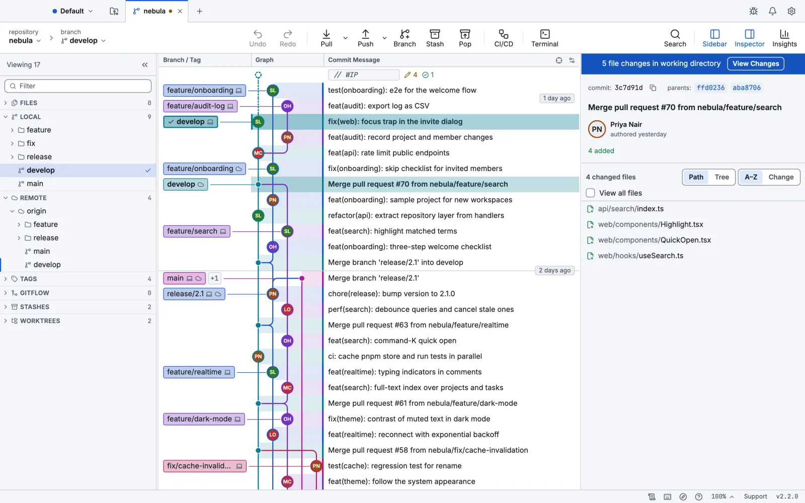</td>
  </tr>
  <tr>
    <td align="center"><sub>Searchable preferences</sub></td>
    <td align="center"><sub>The light theme</sub></td>
  </tr>
</table>

## Installation

### macOS

1. [Download the `.dmg`](https://gittree.app/api/download/macos): one universal app for Apple silicon and Intel.
2. Open the downloaded `Git-Tree_<version>_universal.dmg`.
3. Drag **Git Tree** into **Applications**.
4. Open **Git Tree** from Applications, Launchpad or Spotlight.

Releases are signed with an Apple Developer ID and notarized by Apple, so macOS opens them without a warning. To check the app yourself:

```bash
codesign --verify --deep --strict --verbose=2 "/Applications/Git Tree.app"
spctl --assess --type execute --verbose "/Applications/Git Tree.app"   # "accepted, source=Notarized Developer ID"
```

### Windows

1. [Download the installer](https://gittree.app/api/download/windows): `Git-Tree_<version>_x64-setup.exe`.
2. Run it. GitTree installs for all users on the computer, so Windows asks for administrator permission.
3. Open **Git Tree** from the Start menu.

GitTree uses Microsoft Edge **WebView2**, which Windows 11 includes; on Windows 10 the installer sets it up if it is missing.

> [!IMPORTANT]
> The Windows installer is not code-signed yet, so Windows SmartScreen may say *"Windows protected your PC"*. Install GitTree only from [gittree.app](https://gittree.app) or this repository's [Releases page](https://github.com/git-tree-app/gittree/releases), check the file's checksum ([Verify your download](#verify-your-download-optional)), then choose **More info → Run anyway**.

### Linux (Ubuntu and Debian)

GitTree needs Git 2.39 or newer. Ubuntu 24.04 and Debian 12 already have it. **Ubuntu 22.04 and Linux Mint 21 ship Git 2.34**, so add a current Git first:

```bash
sudo add-apt-repository ppa:git-core/ppa
sudo apt update
sudo apt install git
```

1. [Download the `.deb`](https://gittree.app/api/download/linux): `Git-Tree_<version>_amd64.deb` (or the stable name `Git-Tree-Linux.deb`).
2. Install it; apt also installs what it needs (Git, WebKitGTK):
   ```bash
   sudo apt install ./Git-Tree_<version>_amd64.deb
   ```
3. Open **Git Tree** from the application menu.

**Sign-in and passwords.** The app keeps your sign-in and tokens in the system keyring through the Secret Service. GNOME Keyring comes with Ubuntu; on other desktops install `gnome-keyring` or turn on KeePassXC's Secret Service integration. The keyring must be unlocked and have a default collection; if none answers, GitTree tells you what to install and keeps nothing anywhere else. When Git asks for an HTTPS password or an SSH passphrase, the app shows the prompt with `zenity` or `kdialog` (recommended by the package).

### Linux (AppImage, other distributions)

The portable AppImage runs on 64-bit (x86_64) distributions with glibc 2.35 or newer. Git 2.39 or newer must be installed.

```bash
chmod +x Git-Tree-Linux.AppImage
./Git-Tree-Linux.AppImage
```

Keep the AppImage in a folder only you can write to, such as your home folder (not `/tmp` or a shared folder). If it does not start because FUSE is missing, install it with `sudo apt install fuse3`. An AppImage does not register the link the browser uses to return to the app after you sign in, so choose **Manually enter authentication code** in GitTree and paste the code the website shows.

> [!IMPORTANT]
> The Linux packages are not signed by a distribution package authority. Each installer has a detached `.sig` file that GitTree verifies during in-app updates; for a manual download, compare its SHA-256 with `SHA256SUMS.txt` ([Verify your download](#verify-your-download-optional)).

### Install Git

GitTree never bundles or installs Git for you: it uses yours (2.39 or newer).

| | |
|---|---|
| **macOS** | `xcode-select --install` (Xcode Command Line Tools), or `brew install git` with [Homebrew](https://brew.sh) |
| **Windows** | Install [Git for Windows](https://git-scm.com/download/win), then restart GitTree |
| **Linux** | Ubuntu 24.04 and Debian 12: `sudo apt install git`. Ubuntu 22.04 and Linux Mint 21: add the [Git PPA](https://launchpad.net/~git-core/+archive/ubuntu/ppa) first (`sudo add-apt-repository ppa:git-core/ppa && sudo apt update`), then `sudo apt install git`. Restart GitTree afterwards |

Check your version with `git --version`. For Git LFS: `brew install git-lfs` on macOS; on Windows it comes with Git for Windows (or `winget install GitHub.GitLFS`); on Ubuntu and Debian `sudo apt install git-lfs`.

### Verify your download (optional)

Each release attaches `SHA256SUMS.txt` with the SHA-256 checksum of every file. Compare the line for your file with the one you downloaded:

```bash
# macOS
shasum -a 256 ~/Downloads/Git-Tree*.dmg
```

```powershell
# Windows (PowerShell)
Get-FileHash "$env:USERPROFILE\Downloads\Git-Tree*setup.exe" -Algorithm SHA256
```

```bash
# Linux: put SHA256SUMS.txt next to the downloads, then
cd ~/Downloads && sha256sum -c --ignore-missing SHA256SUMS.txt
```

`SHA256SUMS.txt` is published in the same place as the installers, so it catches a corrupted or truncated download, not a tampered release. Download only from the sources named above.

## Getting started

1. **Install GitTree** and [Git](#install-git), then open the app.
2. **Sign in.** Choose **Sign in** (or **Create account**). Your browser opens [gittree.app](https://gittree.app), where you continue with your email or a Git provider and confirm the sign-in. The browser hands you back to the app, which continues by itself.
   - Browser didn't come back? The website shows a one-time code: choose **Manually enter authentication code** in the app and paste it.
   - Signing in never starts a trial. If your account can still start a Pro trial, GitTree offers it once; choose **Start trial** or **Not now**.
3. **Open a repository.** From the start page choose **Open** (a folder on your computer), **Clone** (from a URL or your connected accounts) or **Init** (a new repository). **Scan for Repositories** finds the ones you already have in a folder.
4. **Find your way around.**

   | Area | What it shows |
   |---|---|
   | **Tabs** (top) | One tab per open repository; <kbd>⌘</kbd><kbd>T</kbd> / <kbd>Ctrl</kbd><kbd>T</kbd> opens a new one |
   | **Toolbar** | Undo, Redo, Pull, Push, Branch, Stash, Pop and Terminal, plus the Sidebar, Inspector and Nour toggles |
   | **Sidebar** (left) | Files, local and remote branches, tags, Git Flow, stashes, worktrees and, with a connected account, pull requests and issues |
   | **Graph** (centre) | Branch and tag labels, the lanes and the commit messages; the *WIP* row on top holds your uncommitted changes |
   | **Inspector** (right) | The selected commit's details and changed files, or the staging area and commit message for the WIP row |

5. **Connect a hosting account (Pro).** For a repository on GitHub, GitLab, Bitbucket or Azure DevOps, open **Preferences → Integrations** and connect the account once. The sidebar then lists the repository's pull requests and issues, and the CI/CD view its runs.

A step-by-step guide for every task is in the [GitTree docs](https://gittree.app/en/docs), and [GitTree Learn](https://gittree.app/en/tutorial) teaches Git itself with real GitTree workflows.

## How to…

<details>
<summary><strong>Stage and commit changes</strong></summary>

1. Select the **WIP** row at the top of the graph.
2. Stage a whole file, open it to stage a single **hunk**, or tick individual **lines**. With a file list focused, <kbd>S</kbd> stages and <kbd>U</kbd> unstages the selection.
3. Write a summary (the counter turns red past 72 characters) and an optional description.
4. Choose **Commit**, or press <kbd>⌘</kbd><kbd>Enter</kbd> / <kbd>Ctrl</kbd><kbd>Enter</kbd>. Choose **Amend Previous Commit** to change the last commit instead.
</details>

<details>
<summary><strong>Create and switch branches</strong></summary>

- Choose **Branch** in the toolbar, or right-click any commit → **Create Branch Here…**.
- Double-click a branch label on the graph, or right-click it → **Check Out Branch**. GitTree warns you first if your local changes would be overwritten.
- Right-click a branch to rename or delete it, set its upstream, push it or fast-forward it.
</details>

<details>
<summary><strong>Merge or rebase</strong></summary>

1. Check out the branch that should receive the changes.
2. Right-click the other branch → **Merge *other* into *current*** (or **Rebase *current* onto *other***), or drag the other branch's label onto the current branch.
3. The dialog says whether the merge will conflict. If it does, the conflicted files are listed: open each one in the three-way editor, take a side, combine both or edit the result, then mark it resolved and continue, or abort to go back.
</details>

<details>
<summary><strong>Clean up history with an interactive rebase</strong></summary>

1. Right-click a commit → **Interactive Rebase of the Commits Above…** (or right-click a branch → **Interactive Rebase Current Branch Onto This…**).
2. Drag commits to reorder them, and set each one to *pick*, *reword*, *edit*, *squash*, *fixup* or *drop*.
3. Review what will be replayed, then start. A snapshot is taken first, so **Undo** can reverse the whole rebase.

For a single commit, its menu offers quick edits: **Edit Commit Message…**, **Move Commit Up / Down** and **Drop Commit…**.
</details>

<details>
<summary><strong>Pull, push and force-push safely</strong></summary>

- **Pull** in the toolbar fetches and integrates; the arrow next to it chooses **fast-forward only**, **fast-forward if possible** (merge) or **rebase**.
- **Push** sends the current branch to its remote.
- When a push needs force, GitTree uses `--force-with-lease` with the commit it expects on the remote, so it never overwrites work you haven't seen.
</details>

<details>
<summary><strong>Undo a mistake</strong></summary>

Resets, discards, branch deletions and rebases save a recoverable snapshot before they run. Choose **Undo** in the toolbar to reverse the last one, and **Redo** to apply it again. For anything older, the **reflog** can recover a lost commit onto a new branch.
</details>

<details>
<summary><strong>Stash work and use worktrees</strong></summary>

- **Stash** in the toolbar saves your uncommitted changes; **Pop** brings them back. Right-click a stash in the sidebar to apply, rename or drop it, or **Create Branch from Stash…**.
- The **Worktrees** section of the sidebar checks out another branch in a separate folder, so you can work on two branches at once.
</details>

<details>
<summary><strong>Review pull requests and CI/CD runs (Pro)</strong></summary>

1. Open **Preferences** (<kbd>⌘</kbd><kbd>,</kbd> / <kbd>Ctrl</kbd><kbd>,</kbd>) → **Integrations** and connect GitHub, GitLab, Bitbucket or Azure DevOps.
2. Open a pull request from the sidebar to read its conversation, commits, files and checks; add review comments to lines, then approve, request changes or merge.
3. Open the CI/CD view (<kbd>⌥</kbd><kbd>P</kbd> / <kbd>Alt</kbd><kbd>P</kbd>) to follow runs and their logs, re-run failed jobs, cancel, approve or start a workflow.
</details>

<details>
<summary><strong>Ask Nour (Pro)</strong></summary>

1. Install the coding-agent CLI you want Nour to use (for example Claude Code, Codex or Gemini CLI) and sign in to it.
2. Choose **Nour** in the toolbar, pick the agent, and ask a question in **Ask** mode, or switch to **Agent** to let it make changes in a trusted repository.
3. Review what it did in the graph and the working changes; **Undo** reverses a turn.
</details>

<details>
<summary><strong>Use the command palette and terminal</strong></summary>

- <kbd>⌘</kbd><kbd>⇧</kbd><kbd>P</kbd> / <kbd>Ctrl</kbd><kbd>Shift</kbd><kbd>P</kbd> opens the palette: type to run a command, jump to a branch, find a commit or open a file.
- **Terminal** in the toolbar opens a terminal at the repository root, with your own shell and profile.
- <kbd>⌘</kbd><kbd>/</kbd> / <kbd>Ctrl</kbd><kbd>/</kbd> shows every keyboard shortcut.
</details>

<details>
<summary><strong>Make it yours</strong></summary>

- **Preferences** are searchable; every setting can be reset on its own.
- Pick the dark, light or high-contrast theme, or import your own, and English or Arabic.
- Rebind any shortcut, add custom commands, and set up **profiles** to switch name, email and signing key between work and personal projects.
</details>

## Keyboard shortcuts

<kbd>⌘</kbd> on macOS is <kbd>Ctrl</kbd> on Windows and Linux. Every shortcut can be changed in Preferences; <kbd>⌘</kbd><kbd>/</kbd> shows the full list in the app.

| Action | macOS | Windows and Linux |
|---|---|---|
| Command palette | <kbd>⌘</kbd><kbd>⇧</kbd><kbd>P</kbd> | <kbd>Ctrl</kbd><kbd>Shift</kbd><kbd>P</kbd> |
| Keyboard shortcuts | <kbd>⌘</kbd><kbd>/</kbd> | <kbd>Ctrl</kbd><kbd>/</kbd> |
| Open a repository | <kbd>⌘</kbd><kbd>O</kbd> | <kbd>Ctrl</kbd><kbd>O</kbd> |
| New tab / close tab | <kbd>⌘</kbd><kbd>T</kbd> / <kbd>⌘</kbd><kbd>W</kbd> | <kbd>Ctrl</kbd><kbd>T</kbd> / <kbd>Ctrl</kbd><kbd>W</kbd> |
| Next / previous tab | <kbd>⌃</kbd><kbd>Tab</kbd> / <kbd>⌃</kbd><kbd>⇧</kbd><kbd>Tab</kbd> | <kbd>Ctrl</kbd><kbd>Tab</kbd> / <kbd>Ctrl</kbd><kbd>Shift</kbd><kbd>Tab</kbd> |
| Preferences | <kbd>⌘</kbd><kbd>,</kbd> | <kbd>Ctrl</kbd><kbd>,</kbd> |
| Search the graph | <kbd>⌘</kbd><kbd>F</kbd> | <kbd>Ctrl</kbd><kbd>F</kbd> |
| Jump to HEAD | <kbd>⌘</kbd><kbd>⇧</kbd><kbd>H</kbd> | <kbd>Ctrl</kbd><kbd>Shift</kbd><kbd>H</kbd> |
| Stage / unstage the selected files | <kbd>S</kbd> / <kbd>U</kbd> | <kbd>S</kbd> / <kbd>U</kbd> |
| Commit | <kbd>⌘</kbd><kbd>Enter</kbd> | <kbd>Ctrl</kbd><kbd>Enter</kbd> |
| Next / previous change in a diff | <kbd>F7</kbd> / <kbd>⇧</kbd><kbd>F7</kbd> | <kbd>F7</kbd> / <kbd>Shift</kbd><kbd>F7</kbd> |
| CI/CD runs (Pro) | <kbd>⌥</kbd><kbd>P</kbd> | <kbd>Alt</kbd><kbd>P</kbd> |
| Repo Insights (Pro) | <kbd>⌥</kbd><kbd>I</kbd> | <kbd>Alt</kbd><kbd>I</kbd> |
| Toggle sidebar / inspector | <kbd>⌘</kbd><kbd>J</kbd> / <kbd>⌘</kbd><kbd>K</kbd> | <kbd>Ctrl</kbd><kbd>J</kbd> / <kbd>Ctrl</kbd><kbd>K</kbd> |
| Toggle the drawer | <kbd>⌥</kbd><kbd>T</kbd> | <kbd>Alt</kbd><kbd>T</kbd> |
| Zoom in / out / reset | <kbd>⌘</kbd><kbd>=</kbd> / <kbd>⌘</kbd><kbd>-</kbd> / <kbd>⌘</kbd><kbd>0</kbd> | <kbd>Ctrl</kbd><kbd>=</kbd> / <kbd>Ctrl</kbd><kbd>-</kbd> / <kbd>Ctrl</kbd><kbd>0</kbd> |

## Your GitTree account

Official GitTree builds ask you to sign in with a free **GitTree account**. You create it on the website with your email or a Git provider, and you manage it there.

| Page | What you can do |
|---|---|
| [Dashboard](https://gittree.app/en/dashboard) | Overview, your plan, download links and quick links |
| [Organizations](https://gittree.app/en/dashboard/organizations) | Create organizations (Pro), invite members by email, GitHub username or link, manage roles and seats, accept invitations |
| [Support](https://gittree.app/en/dashboard/support) | Open and follow support tickets |
| [Account settings](https://gittree.app/en/dashboard/settings) | Account type (individual or organization), sign out, **delete your account** |

What the account stores, and what it doesn't, is spelled out in the [Privacy policy](https://gittree.app/en/privacy).

## Privacy and security

- **No usage telemetry.** No analytics, tracking or usage reporting leaves your computer.
- **Your repositories stay local.** GitTree has no cloud copy of your code. With default settings the app talks only to the Git remotes you fetch from and push to, the hosting accounts you connect, an update check you can switch off, and GitTree's servers for sign-in and for this computer's trial and plan check. For that check the app sends the operating system and its version, the processor architecture, the app version and a hashed device ID.
- **AI only when you ask.** When you ask Nour something or draft a message with AI, what you send goes to the coding-agent CLI you picked, and only then.
- **Secrets live only in your OS keychain**: the macOS Keychain, the Windows Credential Manager or the Linux Secret Service (GNOME Keyring, KeePassXC), never in files, logs or URLs.
- **Safe by design.** Snapshots before destructive operations, Undo and Redo, `--force-with-lease`, Cancel as the default in dangerous dialogs, and untrusted repositories can't run hooks.
- **Hands off your setup.** GitTree never edits your Git config, a repository or `~/.ssh` without an explicit action from you.
- **Signed updates.** Every installer has a detached signature that the in-app updater verifies, along with its SHA-256, before anything is installed.

Read the full [Privacy policy](https://gittree.app/en/privacy) and [Terms of use](https://gittree.app/en/terms). To report a security vulnerability, see [Feedback and support](#feedback-and-support).

## Updating and uninstalling

**Updating.** GitTree updates itself. At launch it checks this repository's releases, and when a newer version exists a bar at the top of the window offers it with its release notes. Click **Download** to fetch it (GitTree checks the file's signature and SHA-256 before anything is installed), then **Install and restart**:

- **macOS** replaces the app in Applications and reopens it.
- **Windows** runs the installer after the administrator prompt and reopens GitTree.
- **Ubuntu and Debian** ask for your password and upgrade the `git-tree` package; an **AppImage** is replaced where it is.

If GitTree cannot install it for you, it opens the installer so you can finish by hand. Your settings, repositories list and sign-in stay as they are. Turn the launch check off in **Preferences → General → Automatically check for updates**; **Check for Updates…** in the command palette still works. You can also download the newest version from the website or the [Releases page](https://github.com/git-tree-app/gittree/releases/latest) and install it over the current one. Watch this repository (**Watch → Custom → Releases**) to hear about each new version.

**Uninstalling on macOS.** Quit GitTree and move **Git Tree** from Applications to the Bin. To also remove its settings, caches and logs, delete:

```text
~/Library/Application Support/com.eslamfaisal.opengittree
~/Library/Caches/com.eslamfaisal.opengittree
~/Library/Logs/com.eslamfaisal.opengittree
```

**Uninstalling on Windows.** *Settings → Apps → Installed apps → Git Tree → Uninstall.* To also remove its settings and caches, delete `%APPDATA%\com.eslamfaisal.opengittree` and `%LOCALAPPDATA%\com.eslamfaisal.opengittree`.

**Uninstalling on Linux.** `sudo apt remove git-tree` (or delete the AppImage). To also remove its settings, caches and logs, delete:

```text
~/.config/com.eslamfaisal.opengittree
~/.local/share/com.eslamfaisal.opengittree      # includes logs/
~/.cache/com.eslamfaisal.opengittree
```

(The locations follow `XDG_CONFIG_HOME`, `XDG_DATA_HOME` and `XDG_CACHE_HOME` if you set them.) Disconnect your hosting accounts in **Preferences → Integrations** first if you want their tokens removed from your keychain.

## Troubleshooting

| Problem | What to do |
|---|---|
| *"Git was not found"* | Install Git 2.39 or newer ([Install Git](#install-git)), then restart GitTree. |
| The browser doesn't return to the app after signing in | Use **Manually enter authentication code** in the app and paste the one-time code the website shows. Enter it only in the app that started the sign-in. |
| Ubuntu 22.04 or Linux Mint 21: *"This Git is too old"* | Those systems ship Git 2.34. Add the Git PPA and update Git ([Linux](#linux-ubuntu-and-debian)), then choose **Check again**. |
| Linux: GitTree says no Secret Service answered | Install and start GNOME Keyring (`sudo apt install gnome-keyring`) or enable KeePassXC's Secret Service integration, make sure the default keyring is unlocked, then try again. |
| Linux: the file watcher reports a limit | Your system's inotify limit is reached. The message shows the exact `sysctl` setting to raise. |
| Linux: the AppImage doesn't start | Install FUSE (`sudo apt install fuse3`) and keep the file in a folder only you can write to. |
| The download button opens the Releases page instead of downloading | No installer for your platform is published yet, or GitHub couldn't be reached: pick the file from the release's **Assets** list. |
| Windows SmartScreen warning | Check the file's SHA-256 against the release ([Verify your download](#verify-your-download-optional)), then **More info → Run anyway**. |
| A remote asks for credentials every time | Set up an SSH key in **Preferences**, or connect the account in **Preferences → Integrations** (Pro); secrets are kept in your keychain. |
| A Pro feature is locked | It shows that it is part of GitTree Pro where you would use it; see [Plans](#plans) and the [Pricing page](https://gittree.app/en/pricing). |
| GitTree crashed or closed unexpectedly | Open **Crash Reports…** from the command palette, read the saved report, and post it with the [crash report form](https://github.com/git-tree-app/gittree/issues/new?template=crash_report.yml). |
| Something else | Choose **Report a Bug** in the app, or [open a support ticket](https://gittree.app/en/support), with your GitTree version (bottom-right of the window), your OS version and the steps to reproduce. |

## FAQ

<details>
<summary><strong>What is GitTree?</strong></summary>

A desktop Git client (a Git GUI) for macOS, Windows and Linux. It shows your repository as an interactive commit graph and lets you stage, commit, branch, merge, rebase, stash and push without typing Git commands. It is not the `git-tree` command-line wrapper and not a repository browser website.
</details>

<details>
<summary><strong>Is it free?</strong></summary>

The Free plan covers every local Git feature, for private repositories and commercial use, on macOS, Windows and Linux. GitTree Pro is a paid plan that adds hosting integrations, CI/CD, Nour and AI drafting, Repo Insights and organizations, with a free trial that starts only when you choose it. See the [Pricing page](https://gittree.app/en/pricing).
</details>

<details>
<summary><strong>Why do I need to sign in?</strong></summary>

Official builds use your GitTree account to know your plan and for organizations. You sign in with your email or a Git provider; your repositories and code never leave your computer.
</details>

<details>
<summary><strong>Does GitTree collect any data?</strong></summary>

There is no usage telemetry and no cloud copy of your code. To check this computer's trial and plan, the app sends the operating system and its version, the processor architecture, the app version and a hashed device ID. Your account stores only what the [Privacy policy](https://gittree.app/en/privacy) lists.
</details>

<details>
<summary><strong>Which systems are supported?</strong></summary>

macOS 13 Ventura or later on Apple silicon and Intel (one universal app), 64-bit Windows 10 (22H2) and Windows 11, and 64-bit (x86_64) Linux: Ubuntu 22.04 LTS or later and Debian 12 or later with the `.deb`, and other distributions with glibc 2.35 or newer with the AppImage.
</details>

<details>
<summary><strong>Is there a Linux version?</strong></summary>

Yes, with the same features as on macOS and Windows: a `.deb` package for Ubuntu and Debian and a portable AppImage, both for 64-bit x86_64. It needs Git 2.39 or newer (Ubuntu 22.04 needs the Git PPA first). There is no arm64, Flatpak or Snap build yet.
</details>

<details>
<summary><strong>Does it work with GitHub, GitLab, Bitbucket and Azure DevOps?</strong></summary>

It works with any Git remote over HTTPS or SSH on every plan. With Pro you can also connect GitHub, GitLab, Bitbucket and Azure DevOps accounts, cloud or self-hosted, to browse and clone repositories and to work with pull requests, issues and CI/CD runs inside the app.
</details>

<details>
<summary><strong>Which AI does Nour use?</strong></summary>

The coding-agent CLI you already use, such as Claude Code, Codex or Gemini CLI, under that agent's own plan and terms. GitTree stores no AI key and sells no AI credits.
</details>

<details>
<summary><strong>Can I undo a mistake?</strong></summary>

Yes. Reset, discard, branch deletion, rebase and Nour's agent turns save a recoverable snapshot first, and the toolbar's **Undo** and **Redo** reverse them.
</details>

<details>
<summary><strong>Is the source code available?</strong></summary>

No. GitTree is closed-source software. This repository hosts its releases, public files and issue forms only.
</details>

## Feedback and support

- 🐞 **Found a bug?** Choose **Report a Bug** in GitTree: it opens a support ticket on gittree.app with your GitTree version, platform and OS filled in. Nothing is sent from the app; you describe the problem and submit it. You can also use the [bug report form](https://github.com/git-tree-app/gittree/issues/new?template=bug_report.yml) here.
- 💥 **Did GitTree crash?** Reports are saved on your computer and nothing is sent. Open **Crash Reports…**, read the report, and post it with the [crash report form](https://github.com/git-tree-app/gittree/issues/new?template=crash_report.yml).
- 💡 **Have an idea?** [Request a feature](https://github.com/git-tree-app/gittree/issues/new?template=feature_request.yml).
- 💬 **Account, plan or billing question?** [Open a support ticket](https://gittree.app/en/support) or e-mail [info@gittree.app](mailto:info@gittree.app).
- 🔒 **Security issue?** Please don't open a public issue. Report it privately through [**Security → Report a vulnerability**](https://github.com/git-tree-app/gittree/security/advisories/new).
- ⭐ **Like GitTree?** Star this repository and share [gittree.app](https://gittree.app).
- 📣 **Follow GitTree** on [LinkedIn](https://www.linkedin.com/company/gittreeapp), [Facebook](https://www.facebook.com/gittreeapp/) and [YouTube](https://www.youtube.com/@GitTreeApp) for releases, news and Git lessons.

## About GitTree

GitTree is made and sold by [**Kodmora**](https://kodmora.com), a software house in Cairo, Egypt. More on the [About page](https://gittree.app/en/about); business contact details are on the [Contact page](https://gittree.app/en/contact).

## Legal

© 2026 Kodmora. All rights reserved. GitTree is proprietary software, used under its [Terms of use](https://gittree.app/en/terms) and provided as is, without warranty of any kind. The installers in this repository's releases may be downloaded and used under those terms; no licence to the source code is granted.

Git and the Git logo are trademarks of the Software Freedom Conservancy. GitHub, GitLab, Bitbucket, Azure DevOps, Claude Code, Codex, Gemini CLI, macOS, Windows, Linux, Ubuntu and Debian are trademarks of their respective owners. GitTree is an independent product and is not affiliated with or endorsed by any of them.

---

## بالعربية

<div dir="rtl">

**GitTree** عميل Git مرئي لأنظمة macOS وWindows وLinux: رسم بياني واضح للإيداعات، وتجهيز الملفات حتى مستوى السطر، ومحرر تعارضات ثلاثي، ودمج وإعادة تأسيس مع إمكانية التراجع. مستودعاتك تبقى على جهازك، ولا يرسل التطبيق أي بيانات استخدام. التطبيق والموقع والدروس متاحة بالعربية مع واجهة من اليمين إلى اليسار.

- **الخطة المجانية** تشمل كل ميزات Git المحلية، للمستودعات الخاصة والاستخدام التجاري. **GitTree Pro** يضيف طلبات الدمج والمشكلات وتشغيلات CI/CD من GitHub وGitLab وBitbucket وAzure DevOps، ونور مساعد الذكاء الاصطناعي، وRepo Insights، وإنشاء المؤسسات. الأسعار والعروض في [صفحة الأسعار](https://gittree.app/ar/pricing).
- **تنزيل لنظام macOS** (macOS 13 أو أحدث، معالجات Apple وIntel): [gittree.app/api/download/macos](https://gittree.app/api/download/macos)
- **تنزيل لنظام Windows** (Windows 10 ‏22H2 أو Windows 11، ‏64 بت): [gittree.app/api/download/windows](https://gittree.app/api/download/windows)
- **تنزيل لنظام Linux** (Ubuntu 22.04 أو أحدث، أو Debian 12 أو أحدث، ‏64 بت x86_64): حزمة `.deb` من [gittree.app/api/download/linux](https://gittree.app/api/download/linux) أو ملف AppImage المحمول من [gittree.app/api/download/linux-appimage](https://gittree.app/api/download/linux-appimage)
- يحتاج التطبيق إلى Git بالإصدار 2.39 أو أحدث مثبتًا على جهازك (في Ubuntu 22.04 أضِف أولًا مستودع Git PPA؛ راجع قسم التثبيت على Linux).
- يطلب التطبيق تسجيل الدخول بحساب GitTree مجاني، بالبريد الإلكتروني أو بمزوّد Git.
- الموقع بالعربية: [gittree.app/ar](https://gittree.app/ar) · الميزات: [gittree.app/ar/features](https://gittree.app/ar/features)
- التحديثات: يحدّث التطبيق نفسه. عند فتحه يتحقق من الإصدارات المنشورة هنا، ويظهر شريط أعلى النافذة عند توفر إصدار أحدث: اضغط **Download** للتنزيل (مع التحقق من التوقيع وSHA-256)، ثم **Install and restart**.
- للإبلاغ عن مشكلة: اختر **Report a Bug** في التطبيق لفتح تذكرة دعم على gittree.app، أو [افتح Issue](https://github.com/git-tree-app/gittree/issues/new/choose).
- GitTree من تطوير شركة [Kodmora](https://kodmora.com) في القاهرة، مصر. الكود المصدري خاص وغير منشور.

</div>

<p align="center">
  <sub>Made by <a href="https://kodmora.com">Kodmora</a> · <a href="https://gittree.app">gittree.app</a> · <a href="https://www.linkedin.com/company/gittreeapp">LinkedIn</a> · <a href="https://www.facebook.com/gittreeapp/">Facebook</a> · <a href="https://www.youtube.com/@GitTreeApp">YouTube</a></sub>
</p>
